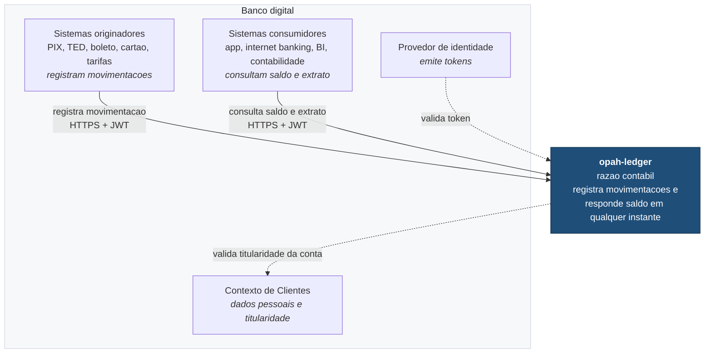
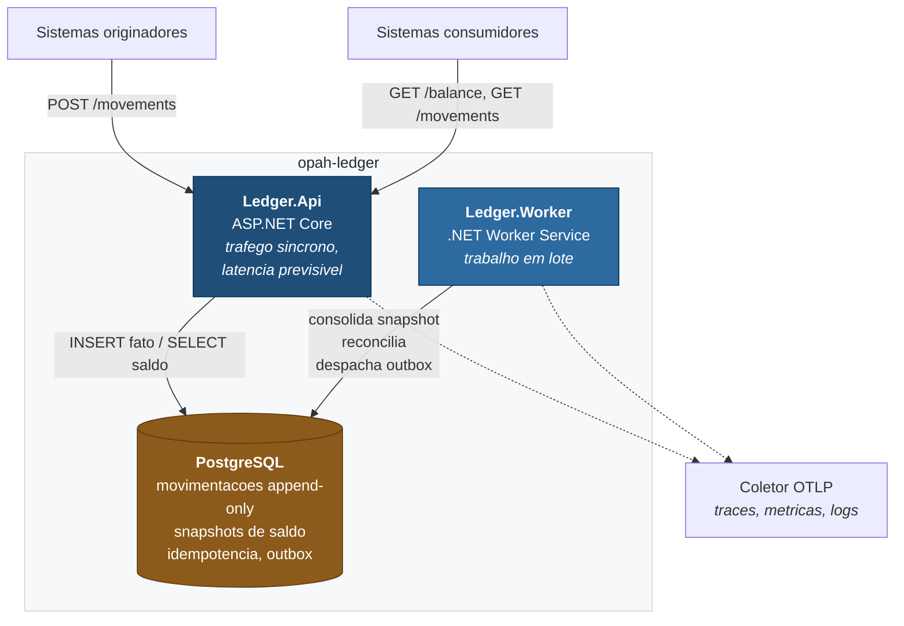
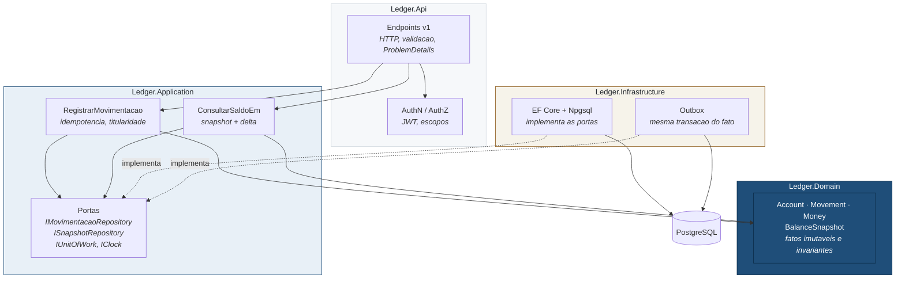
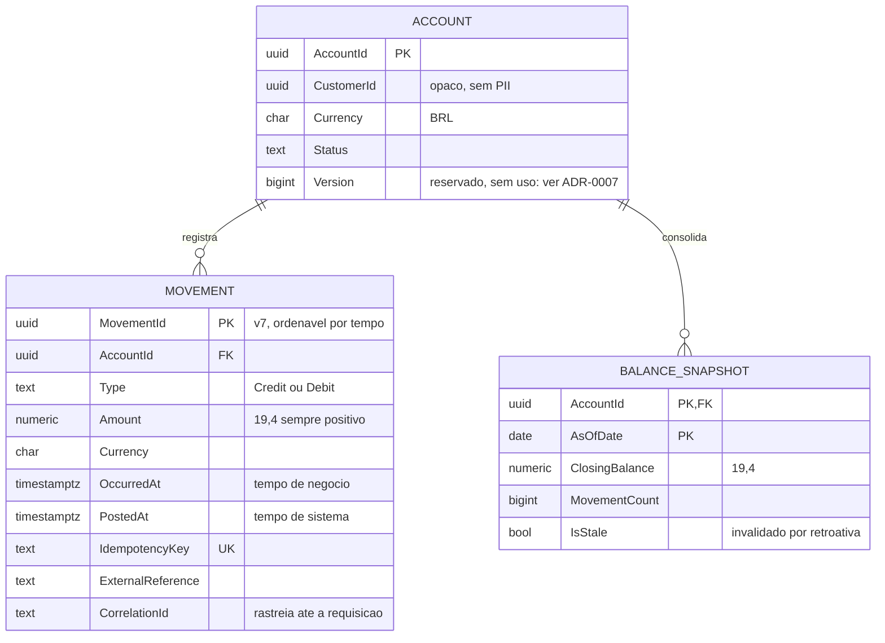

# Arquitetura

Diagramas no modelo C4, em três níveis de zoom. As decisões que produziram esta
estrutura estão em [adr/](adr/); aqui está o resultado.

> **Nota sobre a notação.** Os diagramas usam `flowchart` do Mermaid com
> agrupamentos, e não a extensão `C4Context`. O motivo é prático: a extensão C4
> do Mermaid ainda é experimental e o layout dela no GitHub é instável. Como
> todo requisito obrigatório do desafio depende de a documentação estar legível
> **neste repositório**, escolhi a notação que renderiza de forma confiável.

---

## Nível 1 — Contexto

Onde o sistema se encaixa e quem fala com ele.

Dois pontos de leitura:

**O ledger não guarda dado pessoal.** Ele referencia contas por identificador e
consulta o contexto de Clientes quando precisa de titularidade. Minimização é a
primeira camada de proteção, antes de criptografia ou controle de acesso — ver
[ADR-0009](adr/0009-protecao-de-dados-sensiveis.md).

**O ledger não decide se um débito é permitido.** Quem origina a movimentação já
tomou essa decisão; o razão registra o fato consumado. É a premissa
[PR-03](premissas.md#pr-03), e é a de maior impacto no desenho.

---

## Nível 2 — Containers

Os processos e os armazenamentos.

### Por que dois processos

A API atende requisição síncrona com latência previsível. O worker consolida
snapshot, reconcilia e varre o outbox — trabalho em lote, pesado e tolerante a
atraso.

Num processo único, uma consolidação pesada come o *thread pool* que atende
consultas de saldo. Esse é um mecanismo plausível para a "lentidão em horários
de pico" que o enunciado descreve, e separar os dois o elimina. Também permite
escalar de forma independente: muitas instâncias de API, uma de worker.

Eles compartilham banco e domínio de propósito. A fronteira aqui é de perfil de
carga, não de domínio — ver [ADR-0001](adr/0001-monolito-modular.md).

### O que o worker não é

O worker **não** está no caminho crítico de nenhuma operação. Se ele estiver
parado:

- a escrita funciona normalmente;
- a consulta de saldo cai no cálculo direto — mais lenta, igualmente correta.

Isso é consequência de o snapshot ser cache descartável
([ADR-0004](adr/0004-snapshot-de-saldo.md)). A falha do componente que produz a
otimização degrada latência, nunca correção.

---

## Nível 3 — Componentes

O interior da API. As dependências apontam só para dentro.

### A seta que importa

Repare na direção de `ef -. implementa .-> portas`. A infraestrutura depende dos
casos de uso, nunca o contrário. `Ledger.Application` declara o que precisa como
interface; `Ledger.Infrastructure` implementa.

É inversão de dependência, e tem uma consequência concreta: trocar PostgreSQL
por outro banco não toca em uma linha de caso de uso nem de domínio.

### A regra mais forte do projeto

`Ledger.Domain` não tem **nenhuma** `PackageReference`. Ele não conhece banco,
HTTP, serialização nem injeção de dependência.

E isso é verificado no build, não combinado em reunião:
`Ledger.Architecture.Tests` falha se o domínio ganhar dependência de outra
camada, de EF Core, de ASP.NET, de Npgsql, ou de qualquer pacote externo.

Sem essa verificação, "modular" é intenção que não sobrevive à primeira sprint
sob pressão, porque nada impede um `using` conveniente — e ninguém percebe até
a extração de um serviço ficar caro.

---

## Modelo de dados

Quatro pontos que não se leem no diagrama:

**Não existe coluna de saldo em `ACCOUNT`.** Essa ausência é a decisão central
de [ADR-0002](adr/0002-ledger-append-only.md). Saldo é função sobre o log, não
estado.

**`MOVEMENT` nunca sofre `UPDATE` nem `DELETE`.** Correção de erro é movimentação
compensatória que referencia a original ([PR-06](premissas.md#pr-06)).

**`Amount` é sempre positivo** — o sinal é semântica de `Type`. Isso impede a
classe de bug em que um crédito negativo se torna um débito silencioso. E é
`numeric`, nunca ponto flutuante: há teste de arquitetura que proíbe `double` e
`float` no domínio.

**`BALANCE_SNAPSHOT` é descartável.** Pode ser truncada por inteiro e o worker a
reconstrói do ledger. É o que torna a otimização de
[ADR-0004](adr/0004-snapshot-de-saldo.md) aceitável em dados financeiros.

---

## Contratos da API

Detalhe e exemplos ficam no OpenAPI gerado em `/openapi/v1.json`. O essencial:

| Operação | Contrato |
|----------|----------|
| Registrar | `POST /api/v1/accounts/{accountId}/movements`, header `Idempotency-Key` **obrigatório** |
| Consultar saldo | `GET /api/v1/accounts/{accountId}/balance?asOf=...` |
| Extrato | `GET /api/v1/accounts/{accountId}/movements?from&to&cursor&limit` |

Decisões transversais:

- **Versionamento no path** (`/v1`). Explícito, cacheável, trivial de rotear.
- **Erros em ProblemDetails** (RFC 9457), inclusive os gerados pelo pipeline —
  já verificado por teste: rota inexistente responde `application/problem+json`,
  não HTML.
- **Paginação keyset**, não `offset`. `OFFSET` degrada com a profundidade e, sob
  escrita concorrente, pula ou repete registros entre páginas
  ([ADR-0007](adr/0007-ordenacao-do-ledger.md)).
- **A resposta de saldo diz como foi calculada** (`computedFrom`, `stale`). Em
  finanças, rastreabilidade do número vale mais que elegância do payload: quando
  alguém contestar um saldo, a primeira pergunta é de onde ele veio.
