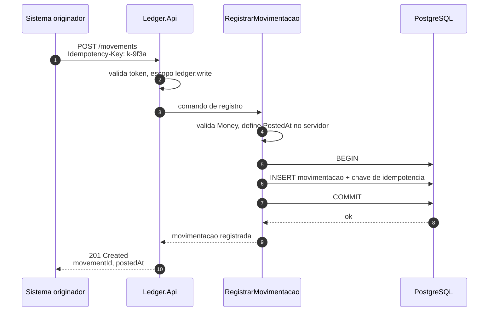
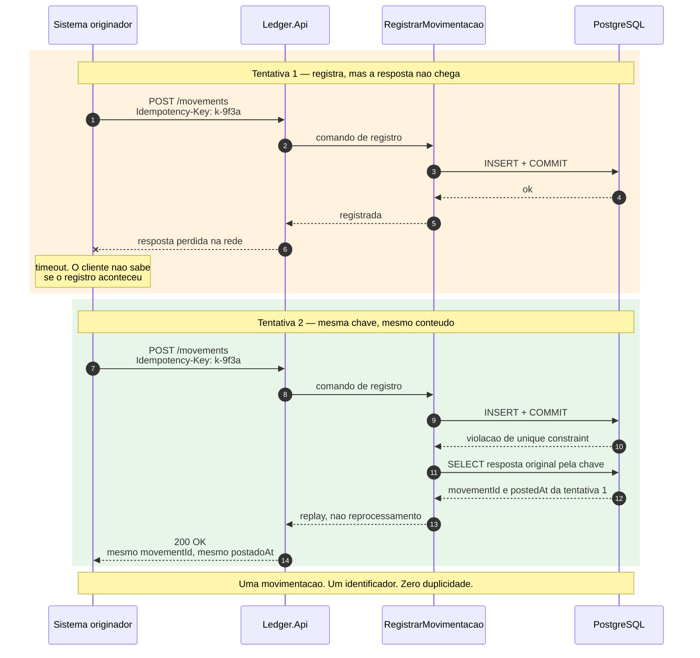
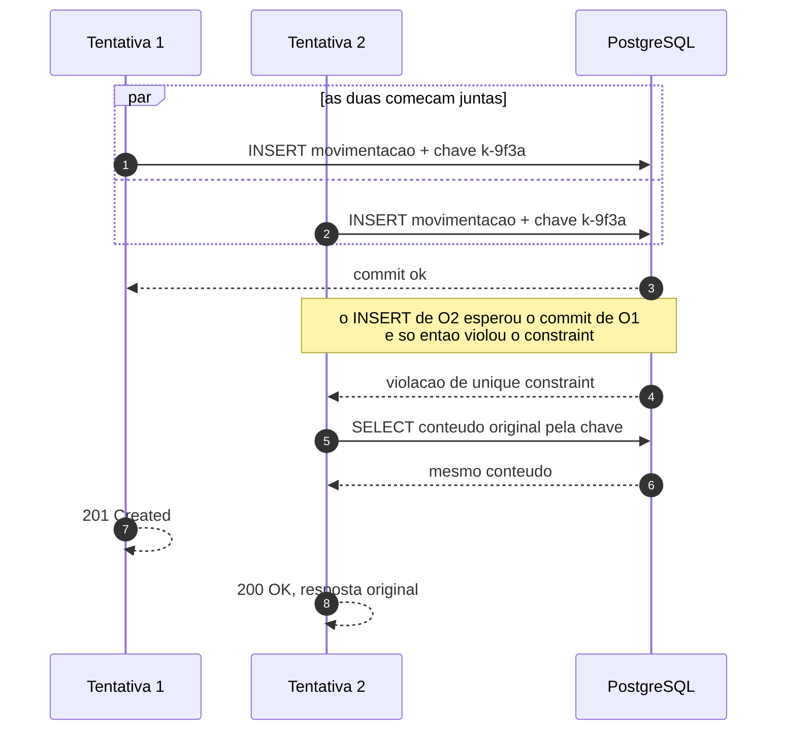
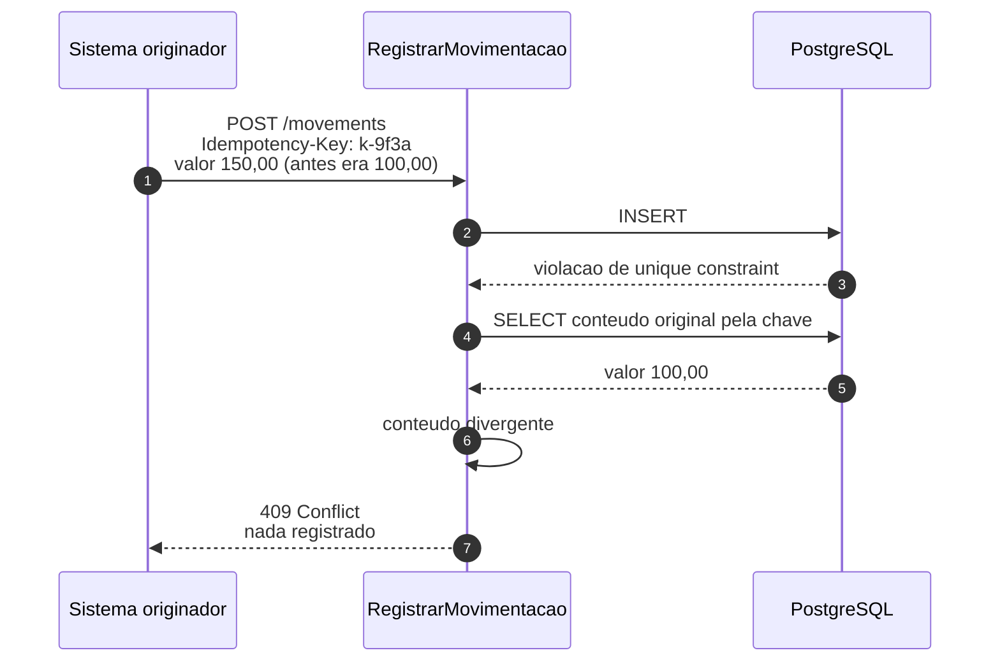
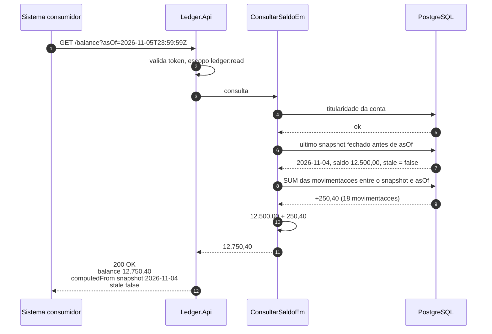
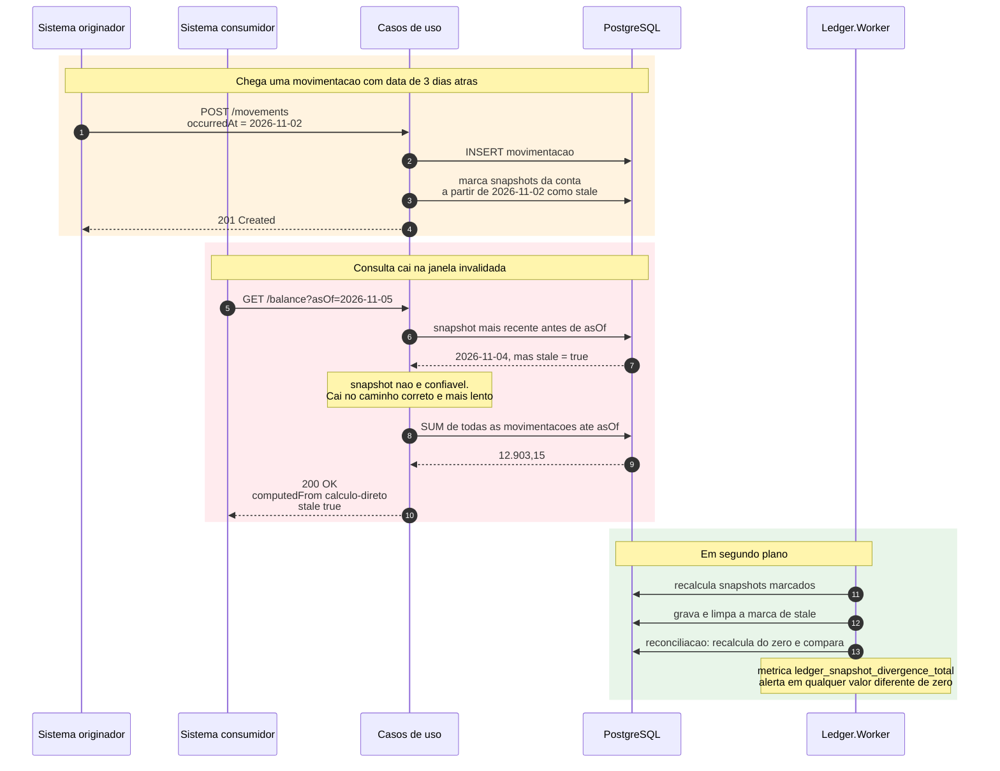
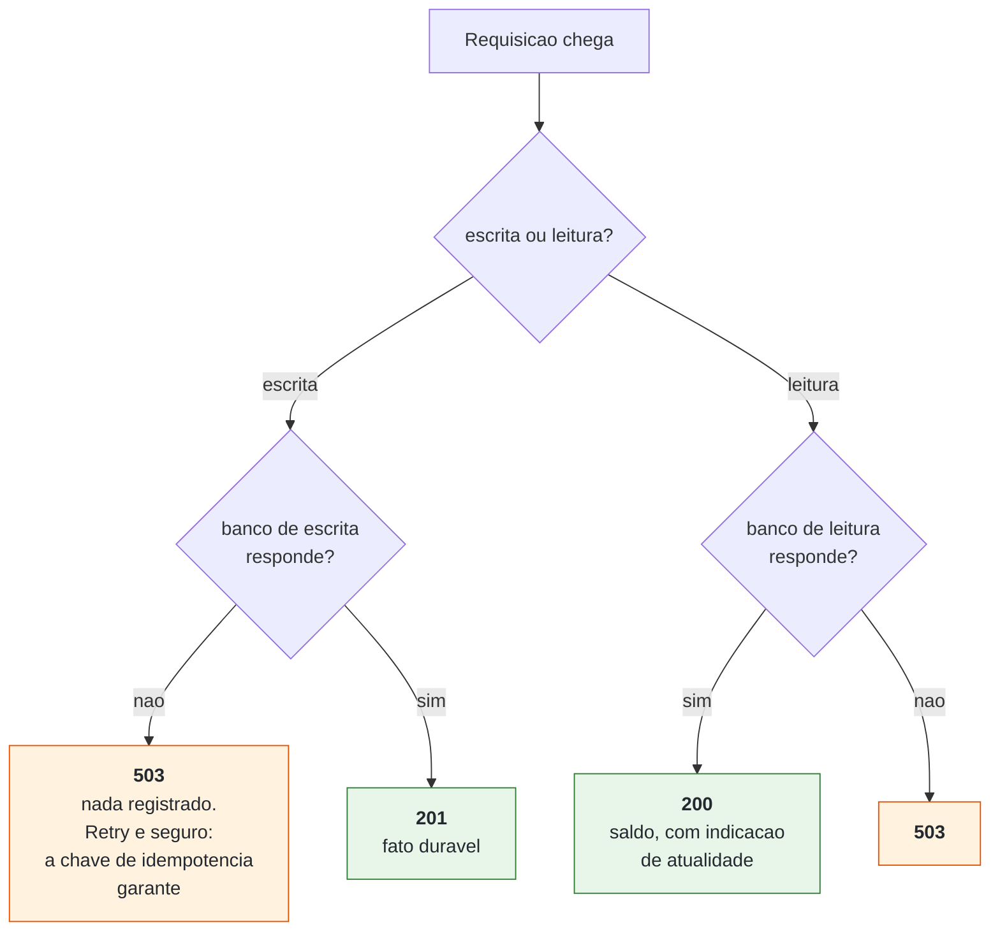

# Fluxos de negócio

Os dois casos de uso do enunciado, em diagramas de sequência, incluindo os
caminhos que não são o caminho feliz — que são onde as decisões arquiteturais de
fato aparecem.

---

## 1. Registrar movimentação — caminho feliz

Três detalhes deliberados:

**`PostedAt` é definido pelo servidor, nunca pelo cliente.** Tempo de sistema
precisa ser confiável; aceitar o relógio do chamador permitiria antedatar ou
pós-datar um registro.

**O `INSERT` da movimentação e o da chave de idempotência estão na mesma
transação.** Se fossem separados, haveria uma janela em que a movimentação
existe sem a chave — e o retry duplicaria.

**`201` só depois do commit.** Quem recebe `201` sabe que o fato está durável.
É a consequência de [ADR-0006](adr/0006-sem-broker-no-caminho-de-escrita.md):
nada de `202 Accepted`, que significaria "recebi, talvez eu registre".

---

## 2. Registrar movimentação — a rede cai e o cliente repete

Este é o fluxo que justifica [ADR-0003](adr/0003-idempotencia-como-contrato.md),
e o cenário que mais importa num ambiente financeiro real: não é exceção, é o
comportamento normal de todo cliente com timeout configurado.

### Por que a garantia está no banco e não na aplicação

A detecção acontece na **violação da constraint**, não numa consulta prévia do
tipo "esta chave já existe?".

A diferença é decisiva sob concorrência. Duas requisições simultâneas com a
mesma chave passariam as duas por uma verificação prévia — ambas veriam "não
existe" — e as duas inseririam. Já a constraint é avaliada pelo banco no commit:
uma vence, a outra recebe a violação. Não há janela.

A garantia não depende de ordem de execução, de cache nem de janela de tempo.
Depende de uma propriedade transacional do banco.

### Por que `200` e não `201` no replay

`201 Created` afirmaria que algo foi criado nesta requisição, o que é falso. E a
resposta devolve **o identificador original** — se devolvesse um novo para o
mesmo fato, criaria exatamente a divergência que a idempotência existe para
evitar, já que o chamador pode estar usando esse identificador para conciliar.

Para que a resposta do replay seja de fato *idêntica* à original, o relógio do
sistema é truncado ao microssegundo: o `DateTimeOffset.UtcNow` tem resolução de
100 ns e o `timestamptz` guarda microssegundos, então sem truncar os dois
carimbos difeririam em até 999 ns. Foi um teste de integração que encontrou isso.

### E quando as tentativas chegam ao mesmo tempo?

É o caso mais comum de verdade: o cliente perde a resposta, repete, e as
tentativas se atropelam. O desfecho correto **não** é `409`.

Todas as tentativas se referem ao **mesmo fato**: uma registra e as outras
recebem a resposta original, com o mesmo identificador. Recusar as perdedoras
com `409` seria punir o chamador por uma falha de rede — e é o erro que uma
leitura apressada da regra produziria.

Há teste de integração com 20 tentativas simultâneas que exige exatamente isso:
uma `Registered`, dezenove `Replayed`, nenhuma em conflito, e um único
identificador entre as vinte respostas.

### O caso do conteúdo diferente

Mesma chave com conteúdo diferente significa bug no chamador: reusou uma chave,
ou mudou o valor entre tentativas. As duas interpretações possíveis — registrar
o novo valor, ou ignorar e devolver o antigo — podem estar erradas, e ambas
movimentam dinheiro.

Adivinhar intenção em sistema financeiro é inaceitável. `409` devolve o problema
a quem tem a informação para resolvê-lo.

---

## 3. Consultar saldo em um instante

A consulta toca **duas** linhas de índice e um *range scan* curto, em vez de
somar cinco anos de histórico. Com snapshot diário, o delta é tipicamente dezenas
de movimentações.

`computedFrom` na resposta é deliberado: quando alguém contestar um saldo, a
primeira pergunta é de onde o número veio. Rastreabilidade do número vale mais
que elegância do payload.

> **O que está implementado hoje é o caminho sem snapshot:** uma única agregação
> no banco, `SUM(CASE WHEN type = 'Credit' THEN amount ELSE -amount END)`,
> filtrada por conta e instante pelo índice
> `ix_movements_account_id_occurred_at`. A resposta devolve
> `source: "DirectSum"`.
>
> É correto em qualquer volume e é o **oráculo** contra o qual o snapshot será
> verificado — ordem deliberada, explicada em
> [ADR-0004](adr/0004-snapshot-de-saldo.md): otimizar sem ter o resultado certo
> medido antes é refatorar sem teste.
>
> O `CASE WHEN` repete a convenção de sinal que `Movement.SignedAmount` define em
> C#. A duplicação é consciente — somar em memória seria inviável — e há teste de
> integração que gera 120 movimentações, soma pelos dois caminhos e exige o mesmo
> número.

### O corte usa o tempo de negócio

`asOf` filtra por `occurredAt`, não por `postedAt`: "qual era meu saldo na sexta"
pergunta sobre **fatos**, não sobre o que o sistema já havia registrado. É por
isso que uma movimentação retroativa registrada hoje aparece no saldo de dez dias
atrás — e também por que ela invalida snapshots, como o fluxo 4 mostra.

O limite é **inclusivo**: uma movimentação cujo `occurredAt` é exatamente o
instante consultado entra no saldo. Ambiguidade dessas é o que vira discrepância
de centavos entre dois sistemas que leem o mesmo razão.

**Saldo em instante futuro é recusado.** Não é conhecível: movimentações ainda
vão chegar para aquele período. Devolver um número apresentaria uma resposta
incompleta como se fosse final, e quem consome não teria como saber.

---

## 4. Consultar saldo numa janela invalidada por movimentação retroativa

É a parte mais sutil do sistema ([PR-04](premissas.md#pr-04)), e a que eu mais
testaria antes de produção — porque um erro aqui produz saldo histórico errado
**sem erro visível**.

### O princípio

> **Correto sempre, rápido quase sempre.** Nunca o contrário.

A degradação é de latência, nunca de valor. O snapshot *stale* não é usado com
ressalva — ele simplesmente não é usado.

E a resposta diz `stale: true`, porque degradação silenciosa é pior que
degradação: quem consome precisa saber que aquele número custou mais caro para
sair, e por quê.

### Por que isso funciona

Porque o snapshot nunca foi a fonte da verdade
([ADR-0004](adr/0004-snapshot-de-saldo.md)). Ele é cache descartável: dá para
marcar como inválido, ignorar, truncar a tabela inteira e reconstruir do ledger.

Se o saldo fosse estado materializado mutável, não haveria de onde recuperar o
valor certo — e a movimentação retroativa seria um incidente, em vez de um
caminho previsto.

---

## 5. Comportamento sob falha

Resumo do que acontece em cada cenário. O detalhamento está em
[ADR-0008](adr/0008-resiliencia-e-degradacao-declarada.md).

A escolha que este diagrama esconde: **não há fila local.** Enfileirar escritas
em memória de processo para drenar depois seria perda de dados com aparência de
resiliência — a instância morre sob instabilidade, e o chamador já recebeu
confirmação.

`503` é honesto. O chamador sabe que não foi registrado, e a chave de
idempotência torna o retry trivial.
